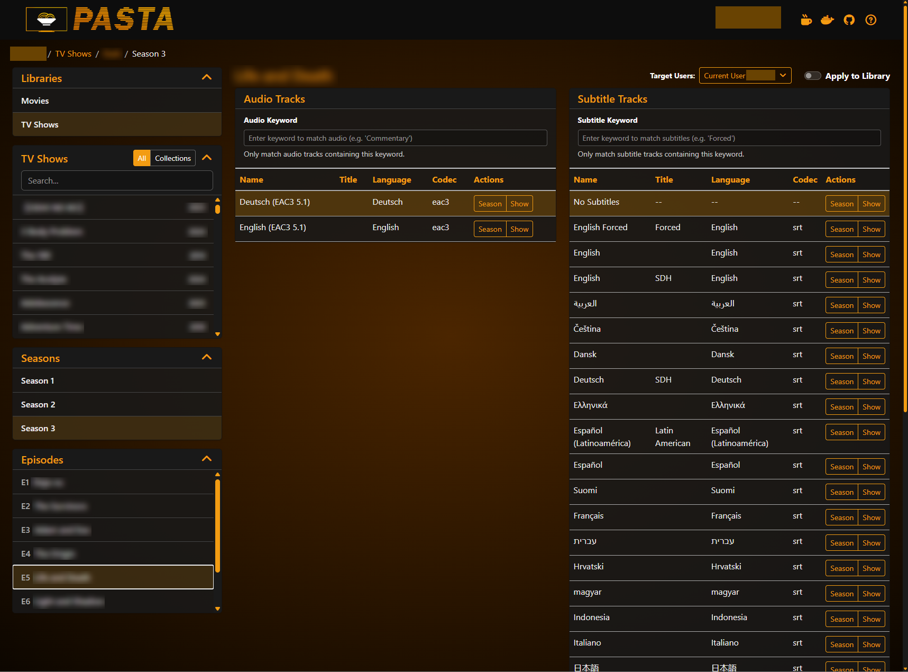
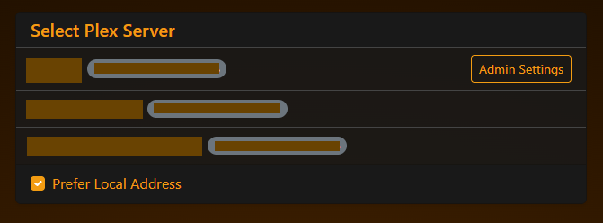
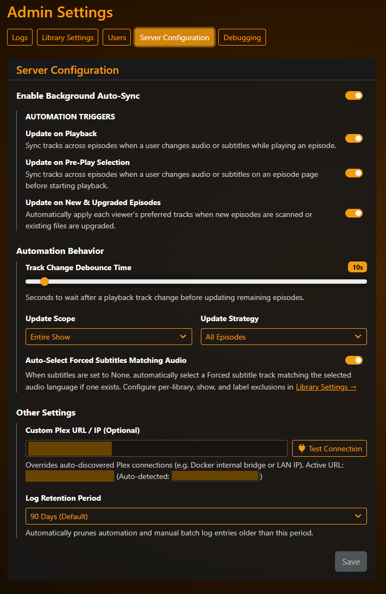
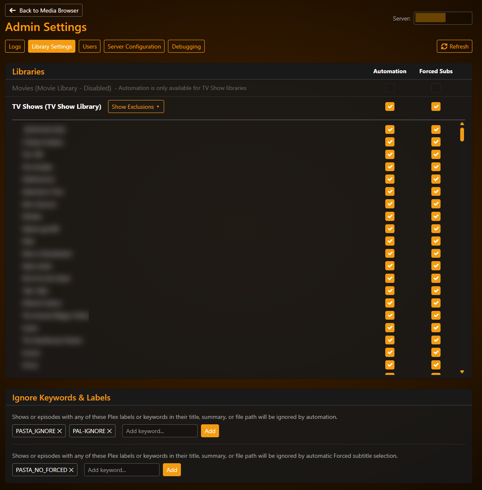
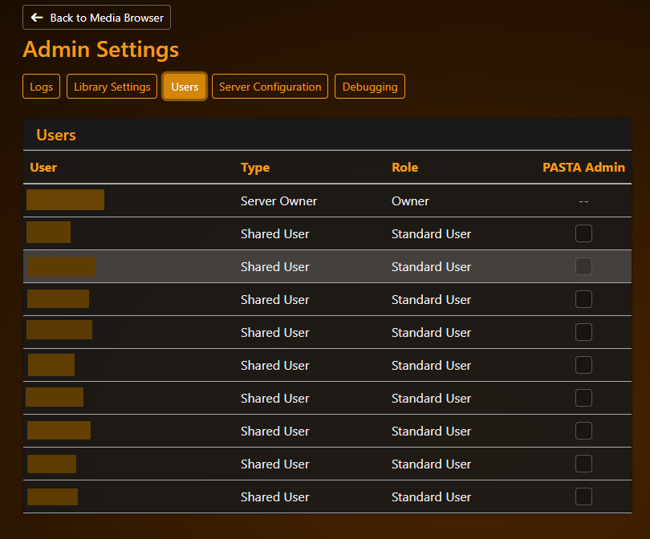
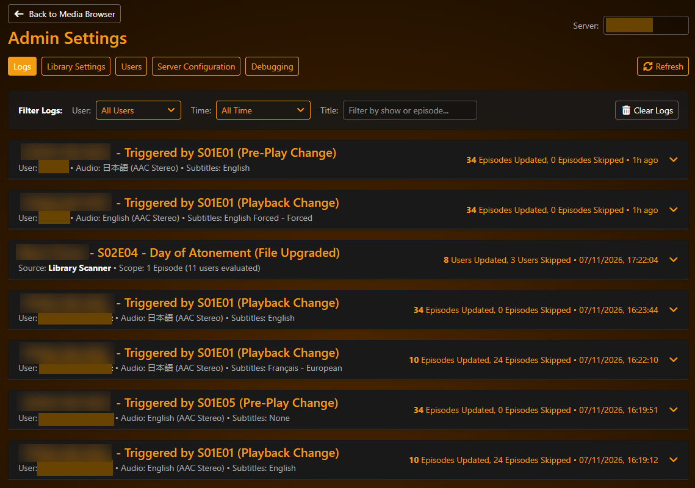
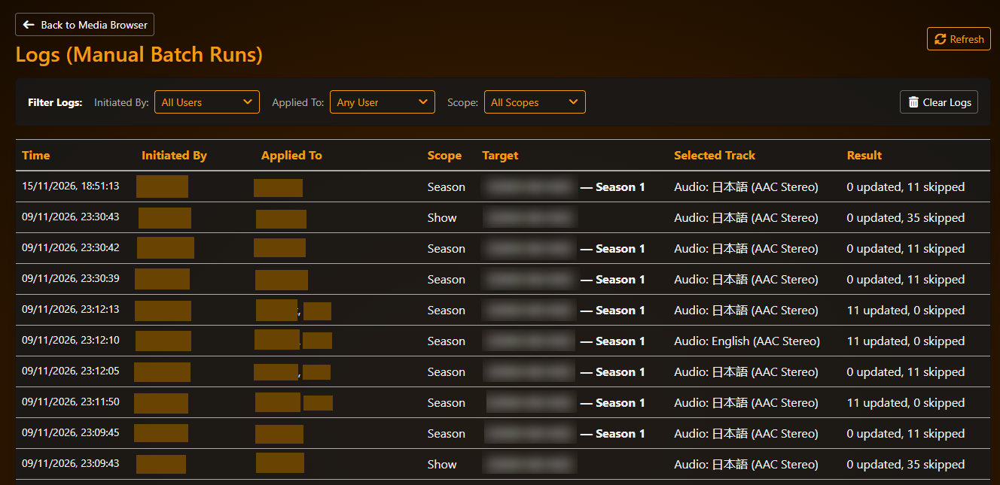
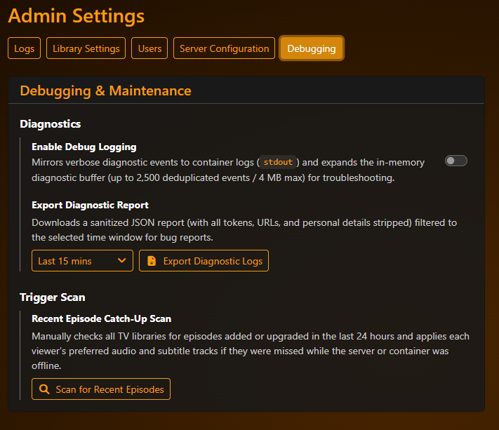

## 

# Plex Audio & Subtitle Track Automation

* **Live Web App (Client Mode):** [https://www.pastatool.com](https://www.pastatool.com)
* **Docker Hub:** [https://hub.docker.com/r/cglatot/pasta](https://hub.docker.com/r/cglatot/pasta)
* **Unraid Installation:** Available in Unraid **Community Applications**
* **Issues & Feature Requests:** [https://github.com/cglatot/pasta/issues](https://github.com/cglatot/pasta/issues)

---

## What is PASTA?

Tired of Plex defaulting to the wrong language on dual-audio shows and forcing you to change audio or subtitle tracks on *every. single. episode*? Frustrated trying to guess which of two identical **English (SRT)** tracks is *Signs & Songs* and which is the full dialogue? Or annoyed when Sonarr upgrades an episode and wipes out your selected tracks?

**PASTA fixes how you manage audio and subtitles in Plex - both manually and automatically:**

* **Inspect & Batch-Update in Seconds:** See the real details behind every track (internal track titles like *Signs & Songs* or *Commentary*, codecs, channels, and `Forced` / `SDH` flags) and apply your choice across a **Season**, **Show**, **Collection**, or **Entire Library** in one click.
* **Set It Once, Watch Hands-Free (Server Mode):** Change your audio or subtitle track on a single episode inside Plex (before pressing play or mid-episode) and PASTA automatically updates the rest of the show in the background.
* **Built for Your Whole Server:** Friends and family you share your Plex server with benefit from background track automation automatically, and you can even give them access to your PASTA web UI so they can batch-update their own tracks (with zero access to admin settings or other users unless you make them a PASTA Admin).

<a href="guide_images/MainScreen.png">
  
</a>

---

## Two Ways to Run PASTA

PASTA can run in two modes depending on how you want to use it:

| Feature | **Client Mode** (`pastatool.com` or `PASTA_MODE=client`) | **Server Mode** (Docker default: `PASTA_MODE=server`) |
| :--- | :--- | :--- |
| **How it runs** | 100% in your browser (static web app) | Self-hosted Docker container |
| **Manual Batch Updates** | Episode, Season, Show, Collection, Library (runs locally in-browser) | Episode, Season, Show, Collection, Library (runs in the background on server) |
| **Multi-Server & Home Users** | Switch between Plex servers and Plex Home profiles (including PINs) | Switch between Plex servers and Plex Home profiles, with independent automation per owned server |
| **Shared User Access** | Shared users can sign in to update their own tracks on servers shared with them | Shared users can sign in to update their own tracks and view their own batch logs (admin features stay hidden unless granted PASTA Admin) |
| **Multi-User Batching** | Current user only | Admins can update tracks for **Current User**, **All Users**, or **Specific Users** at once |
| **TV Track Automation** | No | Automatically syncs tracks across episodes as users watch or when new/upgraded episodes are added |
| **Admin Console & Rules** | No | Per-library, per-show, and keyword rules, auto-forced subtitle matching, activity logs, and delegated PASTA Admins |

---

## Installation

The official `cglatot/pasta:latest` (and `ghcr.io/cglatot/pasta:latest`) image supports both **Server Mode** (the default) and **Client Mode** via the `PASTA_MODE` environment variable.

### 1. Docker Compose - Server Mode (Recommended)

In Server Mode, PASTA runs both the web UI and the background automation service, storing your settings and activity logs in `/config`.

```yaml
services:
  pasta:
    image: cglatot/pasta:latest
    # Also available on GitHub Container Registry:
    # image: ghcr.io/cglatot/pasta:latest
    container_name: pasta
    restart: unless-stopped
    ports:
      - "8080:80"
    volumes:
      - ./appdata:/config
    environment:
      - PORT=80
      - PASTA_MODE=server
      - PASTA_CONFIG_DIR=/config
      # Optional: Enable verbose debug logging to container logs
      # - PASTA_DEBUG=false
      # Optional: Override the auto-generated /config/.pasta_secret with a fixed secret
      # - PASTA_SECRET=your-custom-secret-here
```

> **Tip for Docker / LAN Setups:** Once signed in as the Server Owner, open **Admin Settings -> Server Configuration** if you want to set a direct local LAN URL (e.g. `http://192.168.1.50:32400`) for fastest container-to-Plex communication.

---

### 2. Unraid Installation (Community Applications)

PASTA is available directly in Unraid **Community Applications** - just search for **PASTA** in the Apps tab.

> **Important Note for Unraid Users (Upgrading to PASTA 3.0):**
> The official PASTA 3.0 Unraid template ([cglatot/unraid-templates](https://github.com/cglatot/unraid-templates)) has been submitted and is currently waiting to go live on Community Applications.
>
> Because PASTA 3.0 introduces **Server Mode**, the updated template adds a persistent `/config` path mapping and new environment variables. If you update an existing PASTA 2.x container (or install before the updated template goes live in Community Applications), PASTA will safely run in **Client Mode** and display a dismissible banner in the app.
>
> **Once the v3.0 template is live on Community Applications, upgrade from 2.x with a clean template refresh:**
> 1. Remove your existing **PASTA** container in the Unraid **Docker** tab.
> 2. Go to **Apps -> Previous Apps** and delete the old saved PASTA template (otherwise Unraid will reuse your cached 2.x template).
> 3. Search **PASTA** in **Apps** and click **Install** to pull the new v3.0 template.

---

### 3. Docker Compose - Client-Only Mode (`PASTA_MODE=client`)

If you prefer to self-host the browser-only web app (identical to [pastatool.com](https://www.pastatool.com)) with no stored settings or background automation, set `PASTA_MODE=client`:

```yaml
services:
  pasta:
    image: cglatot/pasta:latest
    container_name: pasta
    restart: unless-stopped
    ports:
      - "8087:80"
    environment:
      - PASTA_MODE=client
```

---

#### Building Locally for ARM Devices (e.g. Raspberry Pi)

`cglatot/pasta` publishes multi-arch images (`linux/amd64` and `linux/arm64`). If you prefer to build from source on an ARM device:

1. `git clone https://github.com/cglatot/pasta`
2. `cd pasta`
3. `docker buildx build -t "cglatot/pasta:latest" --platform linux/arm64 .`
4. `docker compose up -d`

---

## Features & User Guide

### 1. Inspecting Tracks & Running Batch Updates
* **See Every Track Detail:** Select any movie or episode to view its full audio and subtitle track list, including internal track titles (such as *Signs & Songs* vs. *Full*), language, codec, and `Forced` / `SDH` indicators.
* **Keyword Filtering & Smart Matching:** Type a keyword (e.g. `Commentary` or `Signs`) to only match tracks containing that text, or let PASTA automatically pick the closest matching track across episodes when files vary slightly.
* **Choose Your Scope:** Update a single **Episode**, **Season**, **Entire Show**, **Collection** (using the **All / Collections** toggle), or toggle **Apply to Library** to update an entire library at once.
* **Update Multiple Users at Once (Server Mode Admins):** Server Owners and PASTA Admins can use the **Target Users** dropdown above the track tables to apply a track selection to just the **Current User**, **All Users**, or **Specific Users** who have access to that library.

### 2. Multi-Server & Plex Home Support
* **Switch Servers & Profiles Easily:** Connect to any owned or shared Plex server on your account and switch between Plex Home profiles (including PIN-protected accounts) from the user menu.
* **Manage Multiple Owned Servers:** In **Server Mode**, a single PASTA container can monitor and automate multiple Plex servers that you own. You can jump straight into **Admin Settings** from either the server selection screen or the top-right user menu.

<a href="guide_images/ServerSelection.png">
  
</a>

### 3. Background Automation & Server Configuration (Server Mode)
In **Admin Settings -> Server Configuration**, you can control how and when PASTA automatically syncs TV show tracks in the background for every user on your server:
* **Automation Triggers:** Choose which events trigger an automatic sync:
  * **Update on Playback:** Syncs remaining episodes when someone changes audio or subtitles while watching an episode.
  * **Update on Pre-Play Selection:** Syncs remaining episodes when someone changes tracks on an episode page in Plex before pressing play.
  * **Update on New & Upgraded Episodes:** Automatically applies each viewer's preferred tracks (based on their most recently watched episode of that show) whenever new episodes are added or existing files are upgraded by Sonarr.
* **Automation Behavior:**
  * **Track Change Debounce Time:** How long PASTA waits after a playback track change before updating the rest of the show (giving you time to test different tracks without triggering multiple updates).
  * **Update Scope & Strategy:** Choose whether to update the **Entire Show** or **Current Season Only**, and whether to update **All Episodes** or **Upcoming Episodes Only**.
  * **Auto-Select Forced Subtitles Matching Audio:** When enabled, setting subtitles to `None` will automatically select a `Forced` subtitle track matching the selected audio language if one exists (great for foreign dialogue scenes when watching in your native audio language).
* **Other Settings:** Set an optional **Custom Plex URL / IP** (useful if Plex and PASTA are on the same LAN or Docker network) and choose your **Log Retention Period**.

<a href="guide_images/Config.png">
  
</a>

### 4. Library & Per-Show Rules
In **Admin Settings -> Library Settings**, you can fine-tune where automation and automatic forced subtitles are allowed to run:
* **Library & Show Toggles:** Enable or disable **Automation** and **Forced Subs** for entire TV libraries, or click **Show Exclusions** on any library to toggle individual TV shows on or off.
* **Ignore Keywords & Labels:** Add Plex sharing labels or keywords (matched against show/episode titles, summaries, or file paths) to skip specific shows. PASTA includes `PASTA_IGNORE`, `PAL-IGNORE`, and `PASTA_NO_FORCED` out of the box.

<a href="guide_images/LibrarySettings.png">
  
</a>

### 5. Shared Users & Delegated PASTA Admins
You can share your self-hosted PASTA URL with friends and family who have access to your Plex server:
* **Safe Shared User Access:** When a standard shared user signs into your PASTA instance with their Plex account, they can browse libraries shared with them, batch-update **their own** audio and subtitle tracks, and view their own manual batch logs. They **cannot** access Admin Settings, change server rules, or see/modify any other user's tracks.
* **Delegated PASTA Admins:** In **Admin Settings -> Users**, the Server Owner can view everyone with access to the server and optionally check **PASTA Admin** for trusted users. Delegated admins gain access to **Admin Settings** (to manage library/show rules and view server-wide logs) and the **Target Users** selector (to run batch updates for other users) without needing the Server Owner's Plex credentials.

<a href="guide_images/Users.png">
  
</a>

### 6. Activity & Batch Logs
PASTA keeps separate, filterable logs so you can always see what was updated and why:
* **Automated Sync Logs (`Admin Settings -> Logs`):** Shows every background sync triggered by playback, pre-play changes, or newly added/upgraded episodes. Click any entry to expand a full episode-by-episode breakdown of what changed and what was skipped.
* **Manual Batch Logs (`User Menu -> Logs`):** Shows the history of manual batch runs, including who started the batch, which users it was applied to, the target show/season/library, and the results.

| Automated Sync Logs | Manual Batch Logs |
| :---: | :---: |
| <a href="guide_images/LogsAutomated.png"></a> | <a href="guide_images/LogsManual.png"></a> |

### 7. Debugging, Diagnostics & Manual Catch-Up Scan
In **Admin Settings -> Debugging**, you'll find tools to help troubleshoot or catch up after server downtime:
* **Enable Debug Logging:** Turn on verbose logging to your Docker container logs on the fly (or set `PASTA_DEBUG=true` in your container environment).
* **Export Diagnostic Report:** Download a time-filtered diagnostic JSON file (*Last 5 mins*, *Last 15 mins*, *Last 1 hour*, or *All available*) to attach when opening a GitHub issue. All sensitive information (Plex tokens, server URLs/IPs, and usernames) is automatically stripped.
* **Recent Episode Catch-Up Scan:** Manually trigger a scan of episodes added or upgraded in the last 24 hours if your server or container was offline when new media arrived.

<a href="guide_images/Debug.png">
  
</a>

---

## About PASTA

### How It Started
I first created PASTA 7 years ago *(2 weeks shy of exactly 7 years, at the time of writing)* to fill a niche that Plex didn't do itself. There were some scripts around at the time, but using them was a pain and they weren't very user-friendly. So I wanted to make something a bit easier.

It was only supposed to be a temporary thing until Plex built the functionality into Plex itself. Surely it couldn't take *that* long.... could it?

> **Why "PASTA"?**
> 
> When I started development, I was calling it *Audio Track Automation for Plex*, so adding "subtitles" to it and rearranging the letters gave birth to **PASTA**. Super inventive, I know.

### From Browser Tool to Background Automation
PASTA was never intended to have a server-side aspect to it. The whole point of it was to run in a browser and be completely client-side. Partly because that was my strongest skills, but also because I didn't want to deal with the complexity of a server-side engine, storage, secrets, etc.

Luckily, not too long after PASTA, *Plex-Auto-Languages (PAL)* came along. Most people (including me) made the switch to that, as it does it all automatically for you (most of the time anyway)! I figured at that point, PASTA would die out and no longer be needed. But I was, once again, wrong.

> **A Huge Thank You**
> 
> This is the part where I should say **thank you** to everyone that has contributed to, used, donated, or otherwise engaged with PASTA. I honestly haven't used it all that much myself since PAL came along, and I only really kept up with it because you, the people, still wanted it. And I'm grateful for that too. It really feels good to have made something that people value and get use out of.

### Why the Change in 3.0?
I just said that I never intended to have a server-side function, so why the change of heart? A few reasons, really, but the main three are:
* **Brushing up my skills:** My career does not have me doing a lot of dev work anymore, and I wanted to brush up and see what was new in the world of dev.
* **A visual approach to automation:** PAL works great, but changing the config or trying to find out why something didn't work is a bit of a pain (I'm very much a visual person).
* **Breaking past browser limitations:** Some of the long-standing feature requests, and other enhancements I wanted to do, were limited by the client-side design.

The approach I've taken is also slightly different from how PAL does things - whether or not those end up being for better or for worse are yet to be seen! Please do let me know by opening up an issue or pull request!
